# Holly Mixer — Manual de usuario

Las capturas son de la consola de demostración.

Holly Mixer es un control remoto para consolas digitales **Behringer X AIR (XR18)**. Funciona en iPad y en
iPhone, y se conecta a la consola por Wi-Fi o por cable de red.

> ⚠️ **Todo lo que muevas en Holly Mixer cambia la consola de verdad**, y por lo tanto lo que suena en la sala.
> Si quieres practicar, usa la **consola de demostración** (ver [1.4](#14-consola-de-demostración)).

---

## Índice

1. [Conectar a la consola](#1-conectar-a-la-consola)
2. [Pantalla principal del iPad (la mesa de mezcla)](#2-pantalla-principal-del-ipad)
3. [Una tira de canal, botón a botón](#3-una-tira-de-canal-botón-a-botón)
4. [Página de un canal](#4-página-de-un-canal)
5. [El iPhone](#5-el-iphone)
6. [Modo músico («Mi mezcla»)](#6-modo-músico-mi-mezcla)
7. [Copia de seguridad de ajustes](#7-copia-de-seguridad-de-ajustes)
8. [Snapshots de la consola](#8-snapshots-de-la-consola)
9. [Idioma](#9-idioma)
10. [Preguntas frecuentes](#10-preguntas-frecuentes)
11. [Glosario](#11-glosario)

---

## 1. Conectar a la consola

Es la primera pantalla que ves al abrir la app.

### 1.1 Buscar la consola

<p align="center">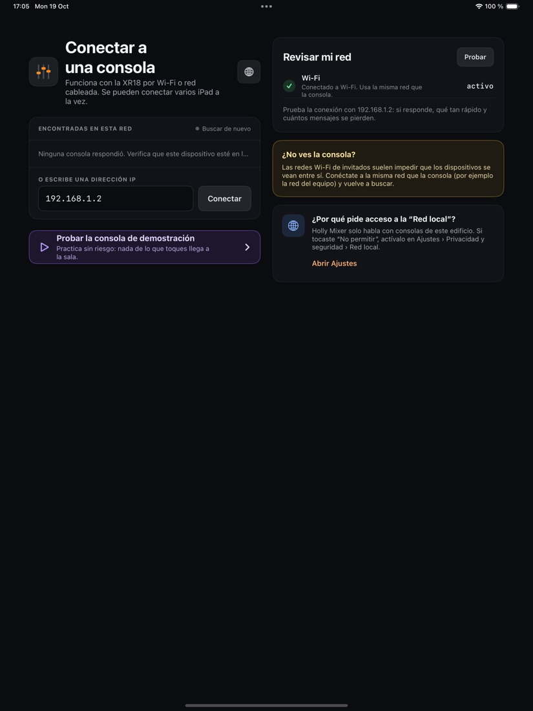</p>

| Elemento | Para qué sirve |
|---|---|
| **ENCONTRADAS EN ESTA RED** | Lista de consolas que respondieron en tu red. Cada una muestra modelo, versión de firmware (*fw*), dirección IP y latencia. Tócala para conectarte. |
| **Buscar de nuevo** | Repite la búsqueda. Mientras busca dice «Buscando». |
| **O ESCRIBE UNA DIRECCIÓN IP** + **Conectar** | Si la consola no aparece, escribe su IP (por defecto `192.168.1.2`) y toca *Conectar*. |
| **RECIENTES** | Consolas a las que ya te conectaste, con la IP y cuándo las usaste por última vez. Un toque para volver a conectar. |
| **Probar la consola de demostración** | Abre una consola simulada. Nada de lo que toques llega a la sala. |
| **Globo (idioma)** | Cambia entre Sistema, English y Español. |

Mientras conecta verás «Conectando a …». Si iOS pregunta por el acceso a la **red local**, toca **Permitir**:
sin ese permiso la app no puede hablar con la consola. Hay un botón **Cancelar** si te equivocaste de dirección.

### Si la IP de la consola cambia

La app no da por hecha ninguna dirección: la primera vez solo busca en la red. Si la dirección guardada deja de
responder (por ejemplo, el router le dio otra IP a la consola), la app **busca la consola sola** y se conecta a ella
cuando es claramente la misma (mismo nombre que una reciente, o la única encontrada). Si no, aparece en
**ENCONTRADAS EN ESTA RED** y la tocas.

### 1.2 Revisar mi red

Una tarjeta de ayuda con tres partes:

- **Revisar mi red / Run**: comprueba el tipo de conexión (Wi-Fi, Ethernet, solo datos móviles, sin red) y hace una
  prueba contra la IP escrita (o, si el campo está vacío, contra la consola encontrada): **¿Consola alcanzable?** (sí/no), **Latencia** (por debajo de 20 ms
  se siente instantáneo) y **Pérdida de paquetes**. Los botones son *Probar*, *Probar de nuevo*.
- **¿Por qué pide acceso a la «Red local»?**: explica el permiso. Si tocaste «No permitir», el botón **Abrir
  Ajustes** te lleva a *Ajustes › Privacidad y seguridad › Red local*.
- **¿No ves la consola?**: las redes Wi-Fi de invitados suelen impedir que los dispositivos se vean entre sí.
  Conéctate a la misma red que la consola y busca otra vez.

### 1.3 Si se corta la conexión

Aparece una franja naranja **«Se perdió la consola · reintentando»** y los controles quedan en solo lectura (se ven
apagados) hasta que la consola responda. El botón **Reintentar ahora** fuerza un nuevo intento. En la barra
superior el indicador pasa a **Reconectando…**.

### 1.4 Consola de demostración

Es una XR18 simulada con canales con nombre, faders, mutes y medidores que se mueven. Sirve para aprender o
enseñar a voluntarios. Mientras está activa, el indicador de conexión dice **Consola demo** y el botón de apagado
se convierte en **Salir de la demo**.

---

## 2. Pantalla principal del iPad

<p align="center">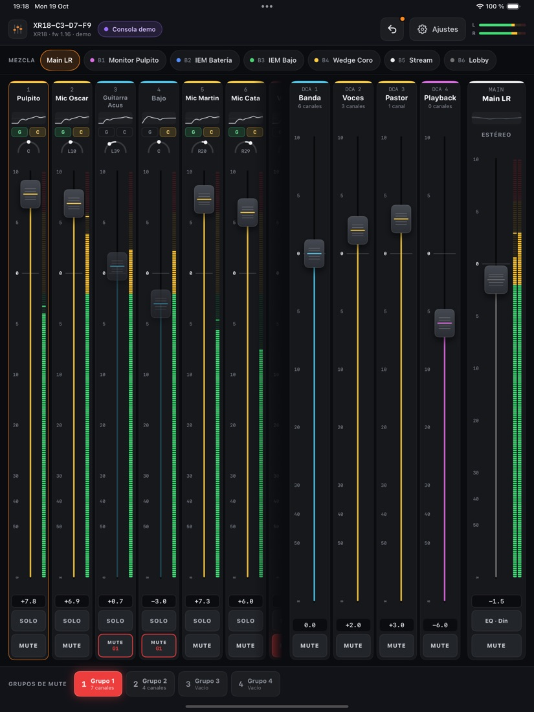</p>

De arriba hacia abajo:

```
┌───────────────────────────────────────────────────────────────────────┐
│  CABECERA  (conexión · deshacer · AJUSTES · medidor)                  │
├───────────────────────────────────────────────────────────────────────┤
│  MEZCLA   [Main LR] [Bus 1] … [Bus 6]   (+ FX 1–4 si se activan)      │
├───────────────────────────────────────────────────────────────────────┤
│  (franjas de aviso: envíos / reconectando / copia de seguridad)       │
├───────────────────────────────────────────────────────────┬───────────┤
│  Tiras de canal (se desplazan hacia los lados)            │  MASTER   │
├───────────────────────────────────────────────────────────┴───────────┤
│  PIE:  GRUPOS DE MUTE  [1] [2] [3] [4]                                │
└───────────────────────────────────────────────────────────────────────┘
```

### 2.1 Cabecera (barra superior)

De izquierda a derecha:

| Elemento | Qué hace |
|---|---|
| **Logo** | La marca de la app. |
| **Nombre de la consola** y debajo **modelo · fw · IP · versión de la app** | Identifica a qué consola estás conectado (o «demo»). |
| **Indicador de conexión** | Verde «Conectado · 12 ms» = todo bien (la cifra es la latencia). Naranja «Reconectando…» = se perdió la consola. Azul/violeta «Consola demo» = simulación. |
| **SOLO · canal · Quitar** (solo aparece si hay solo) | Avisa de que hay canales en solo (escuchas en auriculares/monitor de sala, según la consola). Tócalo para **quitar todos los solos** de golpe. |
| **Deshacer (↶)** | Revierte el último cambio hecho desde la app. Un punto naranja indica que hay cambios por deshacer. Tras deshacer aparece un aviso de 3 segundos («Deshecho: …») que dice qué se revirtió. **Mantén pulsado** para ver la lista de los últimos 8 cambios con su hora. Guarda hasta 100 cambios. |
| **Ajustes (⚙)** | Botón siempre visible con la rueda dentada y el texto «Ajustes»: abre la página con todo lo que no es un fader (ver 2.2). |
| **Medidor Main L/R** | Dos barritas con el nivel de la salida principal. |

En pantallas estrechas (iPad en multitarea, iPhone horizontal) se ocultan los grupos de mute y el
medidor para ganar espacio.

### 2.2 Ajustes (⚙)

Las páginas que abres desde Ajustes tienen su botón **‹ Ajustes** para volver a Ajustes.

El botón **Ajustes** (rueda dentada) está **siempre visible en la barra superior**, en iPad y en iPhone. Abre una sola
página que reúne todo lo que no es un fader, con una descripción debajo de cada elemento:

<p align="center">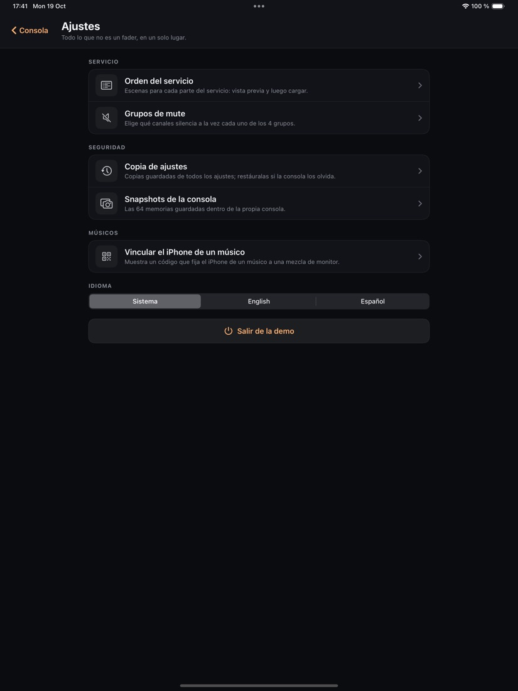</p>

| Sección | Opción | Para qué sirve |
|---|---|---|
| **MEZCLA** | **Mostrar efectos en el selector de mezcla** (interruptor) | Añade FX 1–4 junto a las mezclas de monitor. Apagado por defecto: los efectos casi nunca se tocan en vivo. Si lo apagas estando en una mezcla FX, la app vuelve a Main LR. |
| | **Mostrar faders DCA** (interruptor) | Añade los 4 DCA a la mezcla principal. Apagado por defecto. Los canales se asignan a un DCA en la página de cada canal (*Config.*). |
| | **Grupos de mute** | Elige **qué canales pertenecen a cada grupo**. Arriba eliges el grupo (1–4, con cuántos canales tiene); debajo ves todos los canales con un círculo: **toca un canal para incluirlo (contorno naranja con ✓) y vuelve a tocarlo para quitarlo**. **Quitar todos** vacía el grupo. El rojo solo marca un grupo que está silenciado ahora; para silenciarlo usa el pie. |
| | **Vista simple** | Deja que alguien (por ejemplo el pastor) **silencie y active solo los canales que tú elijas**. Ver la [sección 6b](#6b-vista-simple-para-el-pastor). |
| **SEGURIDAD** | **Copia de ajustes** | Copias de seguridad de todos los ajustes ([sección 7](#7-copia-de-seguridad-de-ajustes)). |
| **MÚSICOS** | **Configurar como músico…** (solo en iPhone) | Deja ese teléfono controlando solo la mezcla de monitor de un músico ([sección 6](#6-modo-músico-mi-mezcla)). |
| **AYUDA** | **Ayuda** | Una guía corta con las cuatro preguntas habituales durante un servicio: por qué un canal no suena, cambiar lo que oye un músico, grupos de mute y restaurar ajustes. |
| **IDIOMA** | Sistema / English / Español | Cambia el idioma de la app. |
| | **Desconectar de la consola** / **Salir de la demo** | Vuelve a la pantalla de conexión (pide confirmación; la consola sigue funcionando). Ya no hay botón de apagado en la barra superior. |


<p align="center">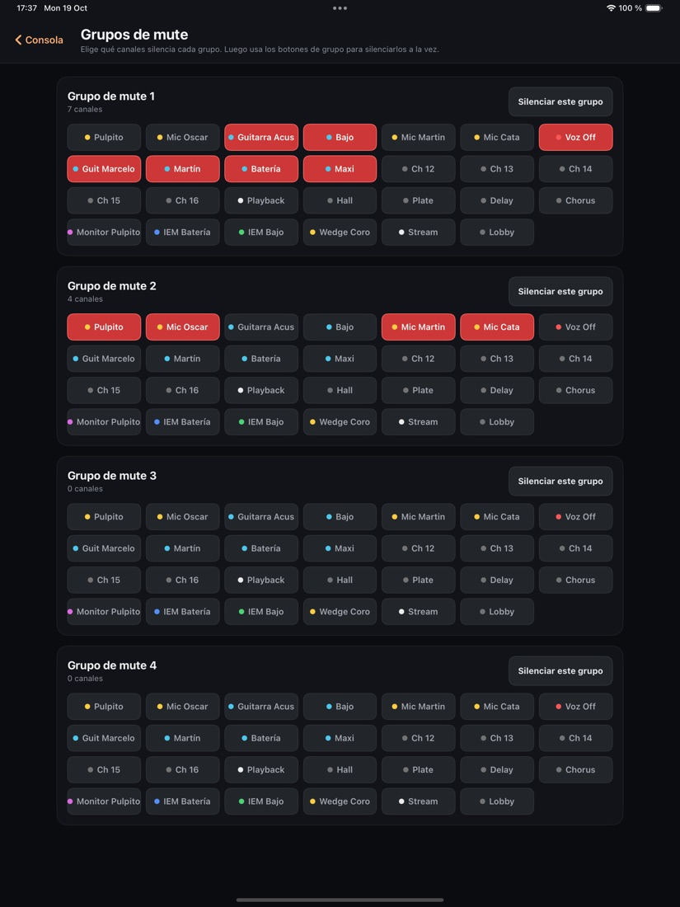</p>

*(Pantalla «Grupos de mute», que se abre desde Ajustes.)*

### 2.3 Selector de mezcla («MEZCLA»)

<p align="center">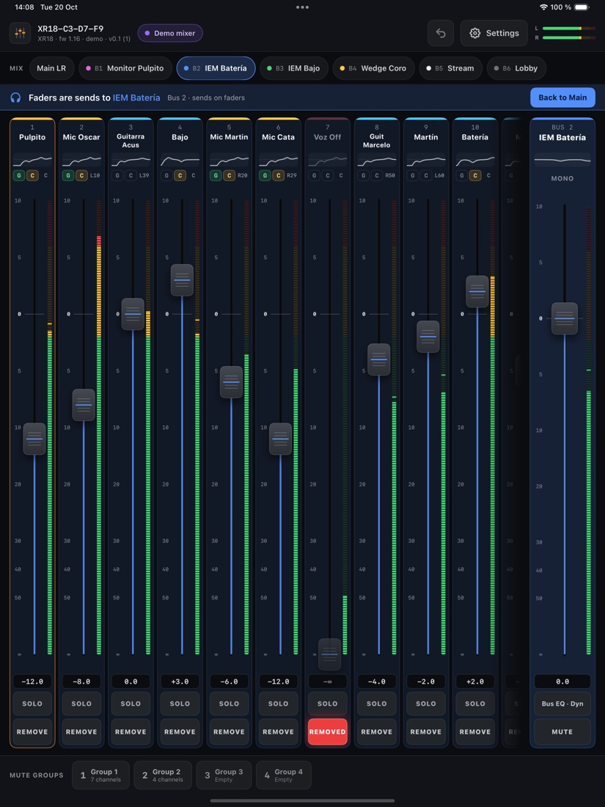</p>

Una fila de píldoras: **Main LR** y **Bus 1 … Bus 6**. (Los efectos **FX 1 … FX 4** solo aparecen si activas *Ajustes → Mostrar efectos en el selector de mezcla*; está **apagado por defecto**.) Decide **qué controlan los faders**:

- **Main LR**: los faders son los niveles normales de cada canal hacia la salida principal.
- **Un bus (1–6)**: los faders pasan a ser **envíos** de cada canal a ese bus. Es la forma de armar la mezcla de
  monitor / retorno de un músico. El bus elegido se pinta con su color.
- **FX 1–4** (opcional): igual, pero hacia los efectos. Aunque estén ocultos, cada canal sigue teniendo sus envíos a FX en su página, pestaña **Envíos**.

Cuando eliges un bus aparece una franja de color: **«Los faders son envíos a …»** con el botón **Volver a Main**.

### 2.4 Franjas de aviso

- **Envíos / Volver a Main**: ver arriba.
- **Se perdió la consola**: ver [1.3](#13-si-se-corta-la-conexión).
- **Copia de seguridad** (naranja): «Los ajustes de la consola cambiaron desde tu última sesión». Pasó, por ejemplo,
  si la consola se apagó y encendió y perdió ajustes. Dos botones: **Revisar y restaurar** y **Mantener los de la
  consola**. Ver [sección 7](#7-copia-de-seguridad-de-ajustes).

### 2.5 Pie de página: grupos de mute

No hay selector de bancos: **todas las tiras están en una sola fila que se desplaza hacia los lados**, en este
orden: canales 1–16, entrada aux, retornos FX y envíos FX. Los **buses** no tienen tira en la fila: se eligen con
las píldoras de *MEZCLA* y su master aparece a la derecha. Los **4 DCA** están **ocultos por defecto**: actívalos en *Ajustes → Mostrar faders DCA* y, con la mezcla *Main LR*,
aparecen al **principio** de la fila. Con la mezcla de un bus o de FX solo se ven las entradas, más el master a la derecha.

En el pie están los botones **GRUPOS DE MUTE 1 2 3 4**. Cada botón muestra **«Grupo N»** y **cuántos canales**
tiene («7 canales»; «Vacío» si no tiene ninguno). Un toque silencia (rojo) o reactiva a la vez todos los
canales del grupo. **Qué canales forman cada grupo:** *Ajustes → Grupos de mute* (ver 2.2), o en la
página de cada canal, pestaña **Config.**, tarjeta **Grupos de mute** (ver 4.2). Los grupos de mute no tienen nombre: la XR18 no puede guardarlo.

---

## 3. Una tira de canal, botón a botón

Cada canal es una columna. De arriba a abajo:

| Parte | Qué es / qué hace |
|---|---|
| **Barra de color** | El color del canal (se cambia en la página del canal). Se atenúa si el canal está en mute. |
| **Número y nombre** | Ej. `1 · Pulpito`. **Un toque** abre la página del canal (el último canal abierto queda con borde naranja). Los canales sin nombre se ven más apagados. |
| **G · C · pan** | Una sola fila con los indicadores de **G**ate y **C**ompresor (encendidos = verde / ámbar) y el **pan** como número: `C` = centro, `L39` = 39 % a la izquierda, `R29` = 29 % a la derecha. Solo informativo (se edita en la consola). |
| **Fader** | Control de volumen. Ver 3.1. |
| **Medidor LED** | Nivel de señal: verde = normal, ámbar = alto, rojo = cerca de saturar. La marca fija arriba es el **pico**. En canales estéreo hay dos columnas (L y R). |
| **Lectura en dB** | Valor actual, ej. `-6.0`. Se pone naranja mientras mueves el fader. «−∞» = silencio total. |
| **SOLO** | Pone el canal en solo. Se enciende en ámbar. No todos los elementos lo tienen. |
| **MUTE** | Silencia el canal. Se enciende en rojo. Vuelve a tocarlo para reactivar. El botón vibra levemente al pulsar. |
| **MUTE con «G1» o «DCA2»** | Si el canal está silenciado **por un grupo de mute o por un DCA silenciado** (aunque su propio MUTE esté apagado), la tira se atenúa y el botón MUTE se rodea de rojo con la etiqueta del grupo que lo silencia. Así sabes *por qué* no suena. |
| **Borde blanco + ↻** | Aviso de **«Cambiado en otro dispositivo»**: otra persona (otro iPad, la consola o X AIR Edit) movió ese canal hace un instante. |

### 3.1 El fader

- **Arrastra la tapa** hacia arriba o abajo. La tapa **no salta** hasta tu dedo: se mueve relativa a donde pusiste
  el dedo, para evitar tirones.
- El valor en dB se lee en la caja numérica bajo el fader (se pone naranja mientras arrastras).
- **Doble toque** en el fader lo devuelve a **0 dB** (posición «unidad»).
- La escala a la izquierda va de **+10** a **−∞**; el **0** se resalta.
- **Solo la tapa mueve el fader.** Si pasas el dedo en horizontal por encima de varios faders para desplazar la
  fila, no se mueven (hace falta un gesto vertical claro).

### 3.2 La tira MASTER (a la derecha, más ancha)

<p align="center">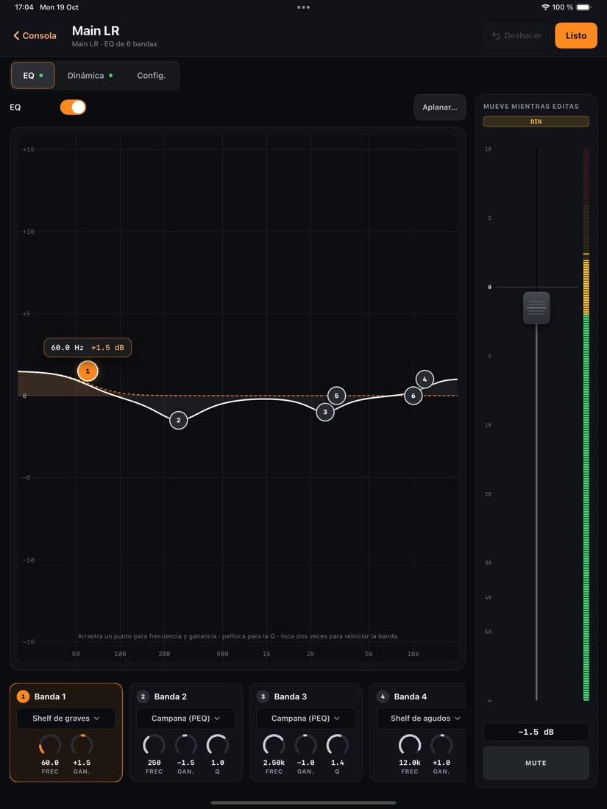</p>

Siempre visible: es **Main LR** (o el **bus / FX** que tengas seleccionado en *MEZCLA*). Tiene lo mismo que una tira
normal, más:

- Etiqueta **MONO** o **ESTÉREO**.
- Botón **EQ · Din** (o **EQ de bus · Din**): abre la página con el EQ y la dinámica del master.

### 3.3 Tiras de bus, FX y DCA

- **Envíos FX** (a continuación de los canales en la misma fila): igual que un canal, con su fader y mute.
- **Buses**: no están en la fila; toca su píldora en *MEZCLA* y su master (fader, mute, EQ) queda a la derecha.
- **DCA 1–4**: un fader que **mueve a la vez todos los canales asignados** a ese grupo, sin cambiar los faders
  individuales de cada uno. Muestra el nombre del grupo y cuántos canales tiene. Su **MUTE** silencia todo el grupo.
  Los canales se asignan a un DCA desde su página (*Config.*).

### 3.4 iPhone en horizontal

Al girar el iPhone se usa esta misma pantalla en versión compacta: se ocultan la miniatura de EQ, G/C y el arco de
pan; **SOLO y MUTE van lado a lado** y las barras se hacen más delgadas para que quepa todo.

---

## 4. Página de un canal

<p align="center">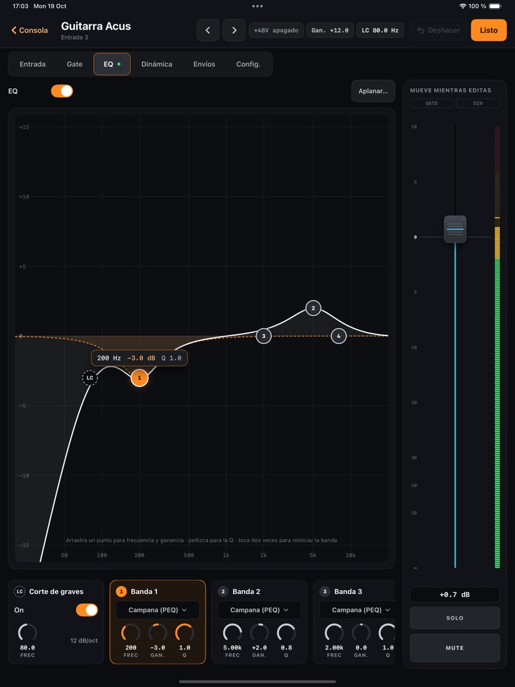</p>

**Cómo abrirla:** toca el nombre del canal (o, en el master, **EQ · Din**). En iPhone, toca el nombre en la fila o
desliza hacia la izquierda.

> **En iPhone** la página del canal tiene una **barra fija abajo** con ‹ › (canal anterior / siguiente), **M**, **S** y el
> fader del canal, para ajustar el volumen mientras editas. Las seis pestañas caben en la pantalla (sin desplazarse). Las
> perillas giran solo si las **mantienes pulsadas un instante** antes de arrastrar (así deslizar la página no las mueve), y
> la ganancia del preamp tiene botones **−1 dB / +1 dB**.

### 4.1 Barra superior

| Elemento | Para qué sirve |
|---|---|
| **Nombre y subtítulo** | Ej. «Pulpito — Entrada 1». |
| **‹ ›** | Pasa al **canal anterior / siguiente** sin volver a la mezcla (solo entradas 1–16). |
| **Chips de estado** | De un vistazo: **+48V activo/apagado**, **Ganancia**, **LC** (corte de graves) con su frecuencia o «LC apagado». |
| **Deshacer** | Igual que en la pantalla principal. |
| **Listo** | Cierra la página. |

### 4.2 Pestañas

Un **punto verde** junto al nombre de la pestaña indica que esa sección está **encendida** (Gate, EQ, Dinámica).
Cada tipo de elemento muestra solo las pestañas que le corresponden (los buses no tienen *Entrada*, por ejemplo).

#### Entrada

<p align="center">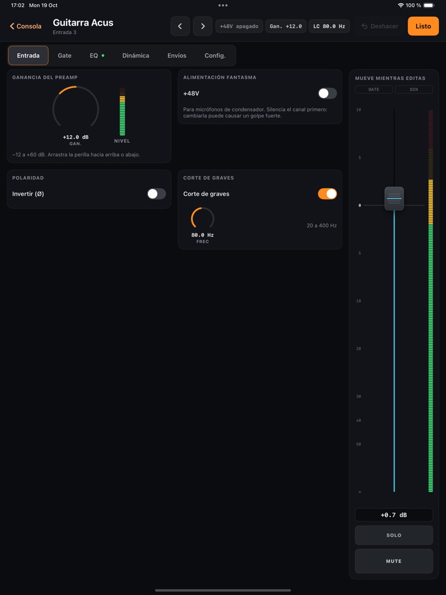</p>
Solo canales de entrada.

| Control | Para qué sirve |
|---|---|
| **Ganancia del preamp (perilla GANANCIA)** | Sube o baja la señal del micrófono, de −12 a +60 dB. Arrastra la perilla hacia arriba o abajo. Junto a ella, un medidor **NIVEL** para ajustar sin pasarte. |
| **Alimentación fantasma (+48V)** | Alimenta micrófonos de condensador. **Silencia el canal antes**: al cambiarla puede sonar un golpe fuerte. Al activarla la app pide confirmación porque puede **dañar micrófonos de cinta** y otras fuentes. |
| **Polaridad · Invertir (Ø)** | Invierte la fase de la señal. Útil cuando dos micrófonos captan la misma fuente y se «cancelan». |
| **Corte de graves (interruptor + perilla FREC)** | Filtra los graves no deseados (golpes de soporte, viento, retumbo). Se ajusta entre 20 y 400 Hz. |

#### Gate

<p align="center">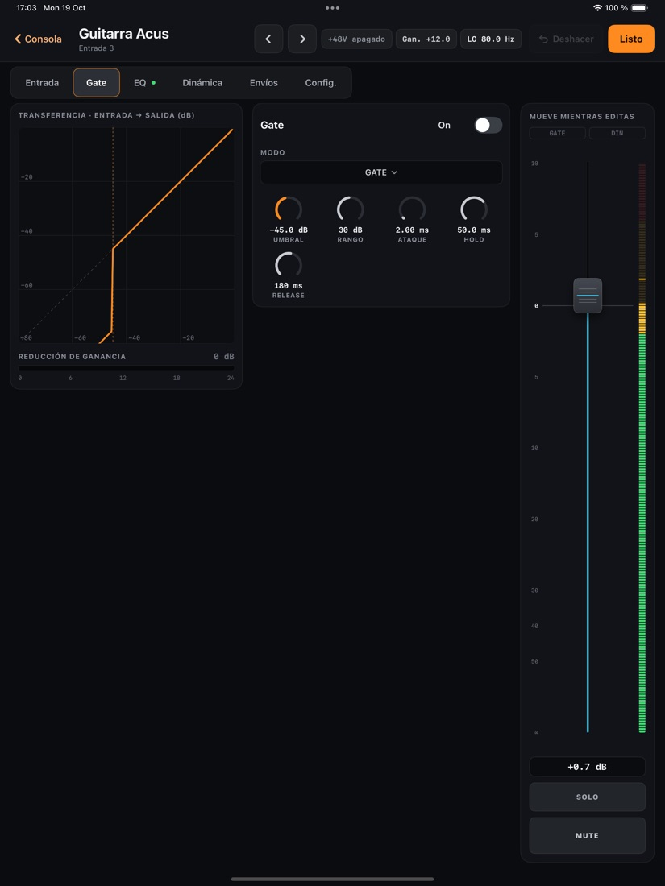</p>
Silencia automáticamente el canal cuando la señal baja de un nivel (quita ruido y bleed entre frases).

- Interruptor **Gate** (encendido/apagado) y gráfico **TRANSFERENCIA · ENTRADA → SALIDA (dB)**.
- **MODO**: EXP2, EXP3, EXP4 (expansor suave a más fuerte), **GATE** (cierre total) o **DUCK** (baja un canal cuando entra otro).
- **UMBRAL**: nivel por debajo del cual el gate actúa.
- **RANGO**: cuánto baja la señal cuando está cerrado.
- **ATAQUE**: qué tan rápido abre.
- **HOLD**: cuánto tiempo se mantiene abierto tras caer la señal.
- **RELEASE**: qué tan rápido cierra.

#### EQ
Ecualizador paramétrico (4 bandas en canales, 6 en buses y Main).

- **EQ in**: enciende o apaga todo el ecualizador (para comparar «con» y «sin»).
- **Gráfico interactivo**: arrastra un punto para cambiar **frecuencia** (horizontal) y **ganancia** (vertical);
  **pellizca** con dos dedos para cambiar la **Q** (ancho de la banda); **doble toque** reinicia esa banda.
  Una burbuja muestra los valores mientras arrastras.
- **Aplanar…**: pone todas las bandas en 0 dB (pide confirmación). No toca el corte de graves.
- **Tarjetas inferiores**: **LC** (corte de graves, con su interruptor y «12 dB/oct») y **Banda 1…n** con tipo
  (*Shelf de graves*, *Campana PEQ*, *Vintage VEQ*, *Shelf de agudos*, *Corte de agudos*), **FREC**, **GAN.** y **Q**.

#### Dinámica

<p align="center">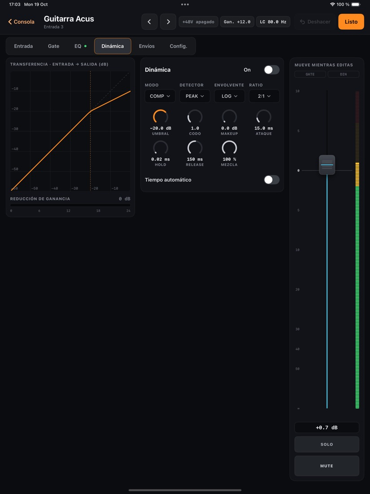</p>
Compresor (o expansor): controla los picos de nivel.

- Interruptor **Dinámica** y gráfico **TRANSFERENCIA**, más el medidor **REDUCCIÓN DE GANANCIA** (cuántos dB está
  bajando el compresor en este instante; «no disponible» si la consola no lo envía).
- **MODO**: COMP (compresor) o EXP (expansor). **DETECTOR**: PEAK (picos) o RMS (promedio). **ENVOLVENTE**: LIN o LOG.
- **RATIO**: cuánto se comprime (de 1.1:1 suave a 100:1 limitador).
- **UMBRAL**: nivel a partir del cual empieza a actuar.
- **CODO**: transición suave o brusca al llegar al umbral.
- **MAKEUP**: ganancia de compensación tras comprimir.
- **ATAQUE / HOLD / RELEASE**: tiempos de respuesta.
- **MEZCLA**: porcentaje de señal comprimida vs. original (compresión paralela).
- **Tiempo automático**: la consola elige los tiempos por ti.

#### Envíos

<p align="center">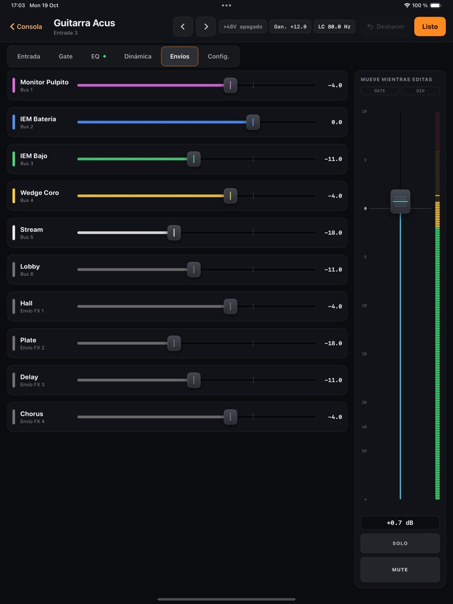</p>
Una fila por cada destino: **6 buses** y **4 FX**. Cada fila tiene el nombre y color del destino, un deslizador
y el valor en dB. Es el nivel que ese canal manda a cada mezcla de monitor o efecto.

#### Config.

<p align="center">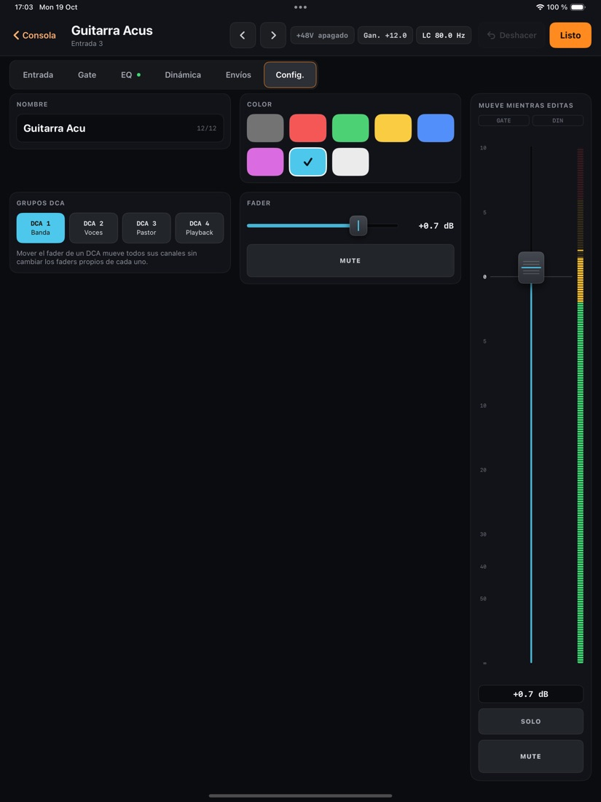</p>

| Tarjeta | Para qué sirve |
|---|---|
| **Nombre** | Renombra el canal (máx. 12 caracteres, con contador). Se guarda al terminar de escribir. |
| **Color** | 8 colores: gris, rojo, verde, amarillo, azul, magenta, cian, blanco. |
| **Grupos DCA** | Marca a qué DCA (1–4) pertenece el canal. Un toque suma o quita. |
| **Grupos de mute** | Marca a cuáles de los 4 grupos de mute (Grupo 1–4) pertenece el canal. Un toque suma o quita (se pone rojo si pertenece). Los botones **GRUPOS DE MUTE 1–4** de la barra superior silencian todos los canales marcados. Los grupos no tienen nombre en la consola XR18. |
| **Fader** | Deslizador de nivel y botón **MUTE** grande. |

### 4.3 Fader lateral — «MUEVE MIENTRAS EDITAS»

En iPad, a la derecha de la página hay un fader con medidor, indicadores GATE/DIN, SOLO y MUTE del canal. Así puedes
**ajustar el volumen mientras editas** el EQ o la dinámica, sin salir de la página.

---

## 5. El iPhone

### 5.1 Vertical: lista de faders horizontales

<p align="center">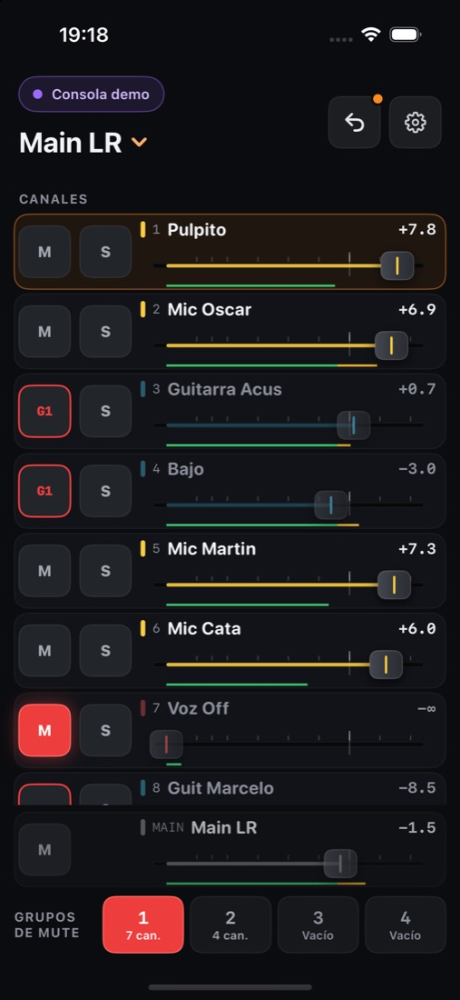</p>

La cabecera tiene:

| Elemento | Qué hace |
|---|---|
| **Indicador de conexión** | Igual que en el iPad. |
| **Nombre de la mezcla ▾** (grande, ej. «Main LR») | Menú para elegir la mezcla: Main LR, Bus 1–6 (y FX 1–4 si están activados en Ajustes). Decide qué controlan los faders. |
| **Deshacer (↶)** | Revierte el último cambio. |
| **Ajustes (⚙)** | Abre la página de Ajustes: grupos de mute, copia de ajustes, vincular como músico, ayuda, idioma y desconectar. |

<p align="center">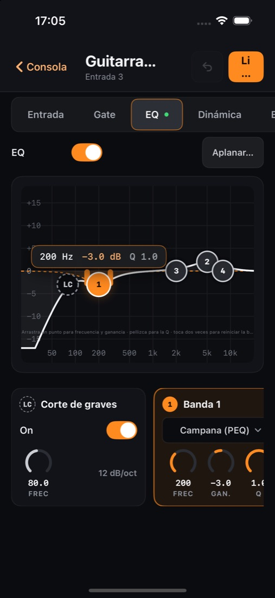 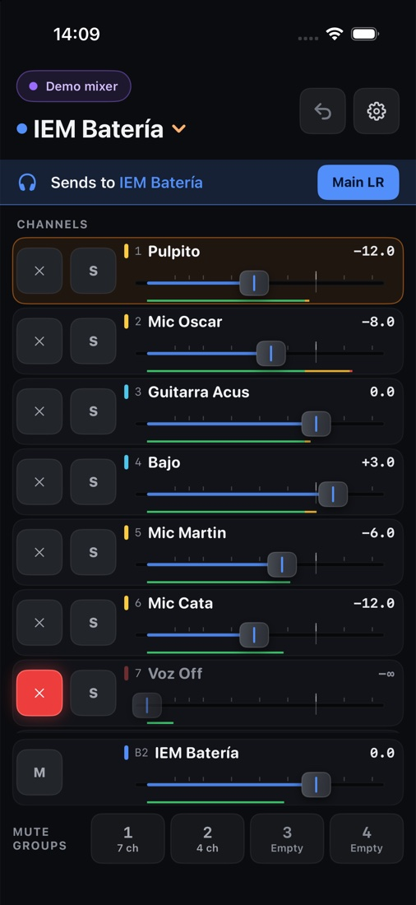</p>

Cada **fila de canal** tiene:

- **M** (mute, rojo) y **S** (solo, ámbar).
- Barra de color, número, nombre y **dB**. **Toca el nombre** (o desliza a la izquierda) para abrir la página del canal.
- Un **fader horizontal** con medidor integrado. Se arrastra de la misma manera que el vertical.

**Todo en una sola lista que se desplaza** (sin bancos), con un título pequeño por tipo: **CANALES**, **AUX · FX**,
**BUSES · ENVÍOS FX** y, si activaste *Mostrar faders DCA*, **DCA** (con la mezcla *Main LR*); 

**Main LR siempre a mano:** debajo de la lista hay una fila fija con el fader y el mute de **Main LR** (en la mezcla de un
bus, es el master de ese bus). Cuando hay un solo activo aparece junto a la conexión un botón **SOLO · … ✕** para quitarlo.

**En la mezcla de un bus** aparece una franja «Envíos a IEM Batería» con el botón **Main LR** para volver, y el botón de
cada fila pasa de **M** a **✕**: *quita el canal de esa mezcla* (envío a −∞) sin silenciarlo en la sala; vuelve a tocarlo
para devolverlo a su nivel anterior. (En el iPad el botón se llama **QUITAR / QUITADO**.)

**Barra inferior:** **GRUPOS DE MUTE 1 2 3 4** con el número de canales, para silenciar o reactivar cada grupo con un toque.

### 5.2 Horizontal

Al girar el iPhone aparece la misma mesa del iPad en versión compacta (ver [3.4](#34-iphone-en-horizontal)).

---

## 6. Modo músico («Mi mezcla»)

Permite que **cada músico regule su propio monitor desde su iPhone**, sin poder tocar nada más de la mezcla.

### 6.1 Configurar el iPhone del músico

*Ajustes → Configurar como músico…* (o, desde la pantalla de conexión, **Soy músico**: no hace falta conectarse antes).
Pide al responsable de sonido estos datos:

| Dato | Para qué sirve |
|---|---|
| **Dirección de la consola** | Por ejemplo `192.168.1.2`. |
| **Retorno** | El bus de monitor del músico (1–6). |
| **Mi canal** | El canal del propio músico, que se destaca en su mezcla. |
| **PIN de salida (opcional)** | 4 dígitos que el músico debe escribir para salir del modo músico (tres fallos bloquean el teclado 30 s). Sin PIN, basta mantener Salir y confirmar. |

Toca **Unirse**. El teléfono queda en modo músico (siempre con el retorno **bloqueado**).

### 6.3 La pantalla del músico

<p align="center">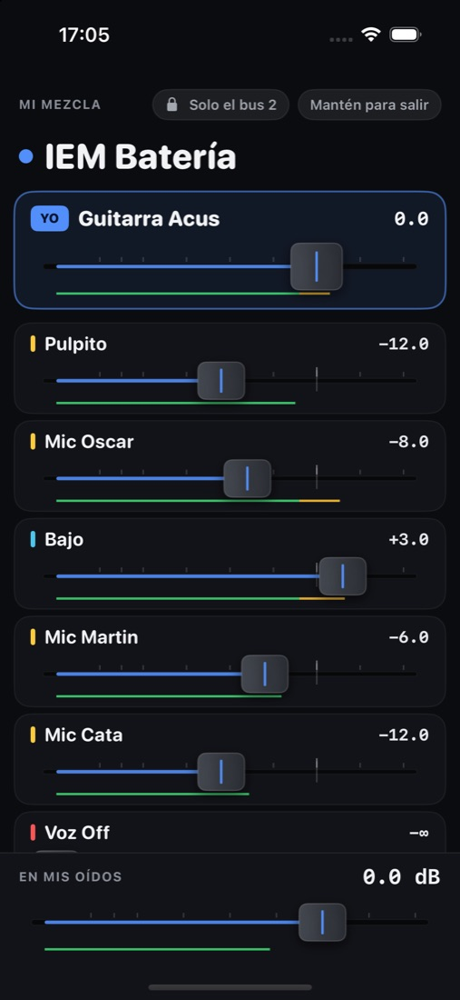</p>

| Elemento | Qué hace |
|---|---|
| **MI MEZCLA** y nombre del bus | Indica qué mezcla estás controlando. |
| **Solo el bus N** (candado) o **Retorno** | Si está bloqueado, muestra el candado. Si es libre, **Retorno** abre una lista para elegir otro bus: marca cada retorno como *En uso* o *Sin usar* y tiene el interruptor **Mostrar retornos sin usar**. Solo cambia el retorno: tu canal sigue igual. |
| **Mantén para salir** | Para salir del modo músico hay que **mantener pulsado dos segundos**, confirmar y, si el responsable de sonido puso un PIN, escribirlo. |
| **YO** | Tu propio canal, fijado arriba, con su fader (cuánto te oyes en tus oídos). |
| **Otras entradas** | Un fader por cada canal activo para subir o bajar a los demás en **tu** mezcla. **Mostrar todas las entradas / Ocultar entradas sin usar** muestra u oculta las que no tienen nombre. |
| **EN MIS OÍDOS** | Fader maestro del bus: el volumen total de tu mezcla. |

El músico **solo** mueve los envíos de su bus; no cambia faders, mutes ni nada de la mezcla principal.

---

## 6b. Vista simple (para el pastor)

Pensada para alguien que no conoce la mesa: ve **solo los canales que tú elijas** (por ejemplo los micrófonos del
pastor), cada uno con **un botón MUTE enorme**, y nada más. No ve la mezcla, EQ, ajustes ni otros canales.

<p align="center">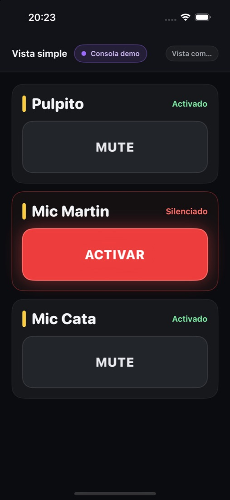 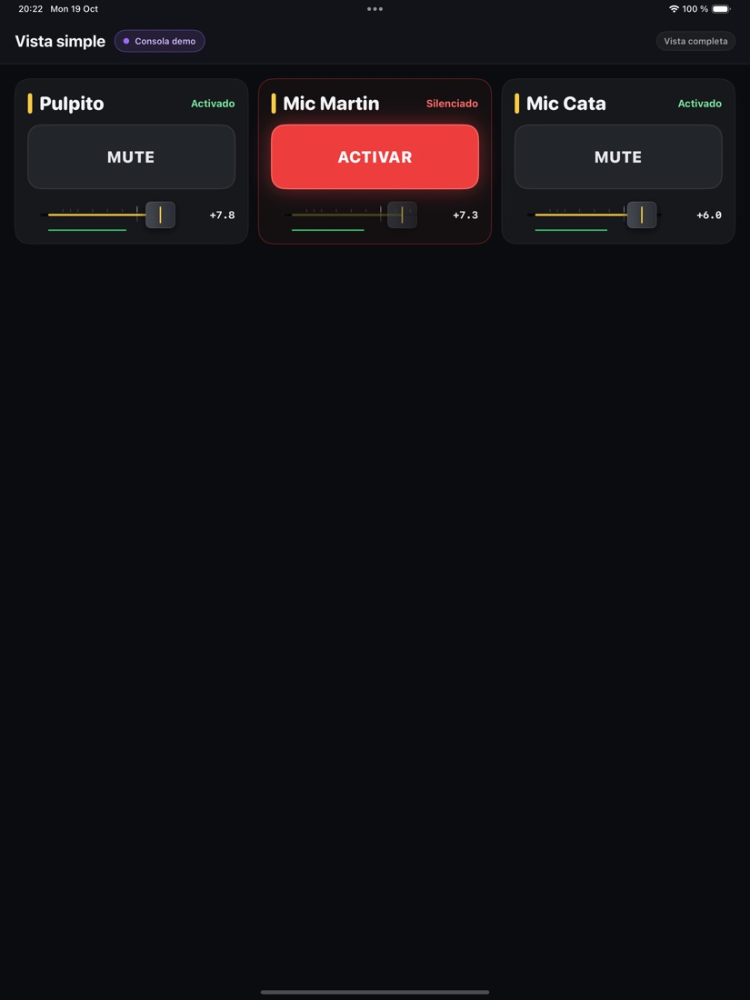</p>

### Configurarla (en tu iPad)

*Ajustes → Vista simple.*

<p align="center">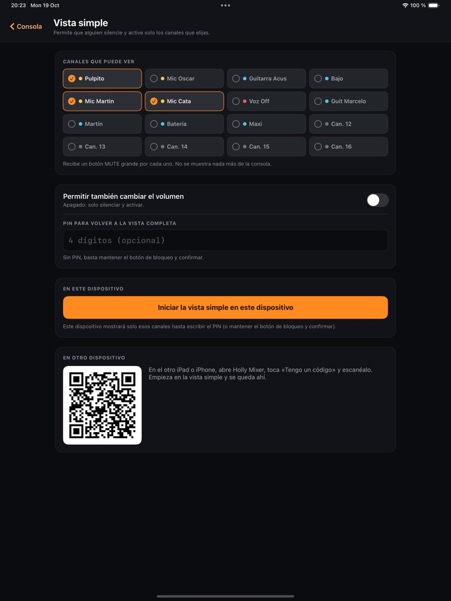</p>

| Control | Para qué sirve |
|---|---|
| **CANALES QUE PUEDE VER** | Toca los canales (1–16) que debe ver. Contorno naranja con ✓ = visible. |
| **Permitir también cambiar el volumen** | Apagado por defecto: solo silenciar y activar. Si lo activas, cada tarjeta añade un fader. |
| **PIN para volver a la vista completa** | 4 dígitos (opcional). Sin PIN, basta mantener el botón y confirmar. |
| **Iniciar la vista simple en este dispositivo** | Este iPad/iPhone pasa a la vista simple y **se queda así**, también si cierras la app, hasta que se escriba el PIN. |
| **En otro iPad o iPhone** | Abre Ajustes → Vista simple **en ese dispositivo**, elige los canales, pon el PIN y toca *Iniciar*. Cada dispositivo se configura una vez. |

### Usarla (el pastor)

- Cada tarjeta muestra el nombre del canal, su estado (**Activado** / **Silenciado**) y un botón grande: **MUTE** para
  silenciarlo y **ACTIVAR** (rojo) para volver a activarlo.
- Si el canal está silenciado por un grupo de mute o un DCA, la tarjeta dice «Silenciado por G1».
- Arriba a la derecha hay un botón pequeño **Vista completa**: **mantenlo pulsado** 2 segundos para volver a la vista
  completa. Pide el PIN si lo definiste.

---

## 7. Copia de seguridad de ajustes

<p align="center">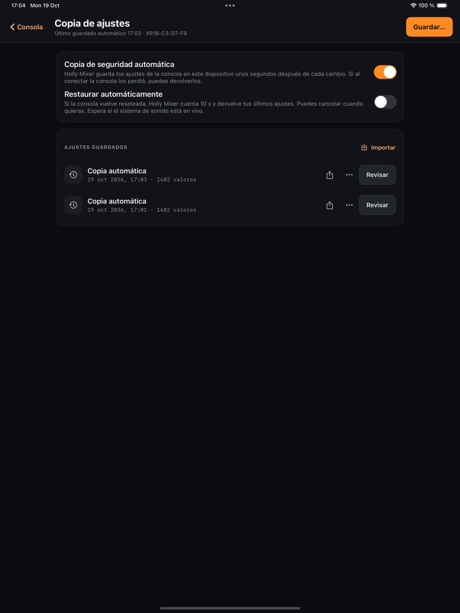</p>

Una XR18 **olvida sus ajustes si se apaga**. Holly Mixer los guarda **en el propio dispositivo** unos segundos
después de cada cambio, para poder devolverlos. Guarda niveles, mutes, nombres, EQ, gate, dinámica, preamp, envíos,
grupos de mute, **efectos (FX 1–4 con sus parámetros), ruteo (principal, aux y USB/P16) y enlaces/opciones de solo**.
Al restaurar, el tipo de cada efecto se escribe antes que sus parámetros. Lo que la consola no responda se ignora.

*Ajustes → Copia de ajustes.*

### 8.1 Cuando la consola «se ve distinta»

Al conectar, si lo que hay en la consola difiere de la última copia, aparece una franja naranja (o un panel «LA
CONSOLA SE VE DISTINTA») con:

- **Revisar y restaurar**: te muestra, agrupado, cada valor que cambiaría. Debajo hay un interruptor **Restaurar
  también la alimentación fantasma +48V**, **apagado por defecto** (cambiarla con el sistema en vivo puede causar golpes
  o dañar micrófonos de cinta). Luego **Restaurar** y una confirmación final.
- **Mantener los de la consola**: descarta la diferencia y sigue con lo que tiene la consola.

### 8.2 Ajustes de la página

| Control | Qué hace |
|---|---|
| **Copia de seguridad automática** | Guarda en segundo plano tras cada cambio. |
| **Restaurar automáticamente** | Si la consola vuelve reseteada, cuenta **10 s** («Restaurando tus ajustes en N s») y devuelve la última copia. Puedes **Cancelar** en cualquier momento. **Espera** mientras haya sonido en la sala. |
| **Guardar ahora…** | Guarda una copia manual con nombre (p. ej. «Domingo, estado ideal»). |
| **Importar** | Trae una copia exportada desde otro dispositivo. |

### 8.3 Lista «AJUSTES GUARDADOS»

Cada copia muestra su nombre (o «Copia automática»), fecha y número de valores. Botones: **Revisar** (restaurarla),
**Compartir copia** (exportar), **Cambiar nombre** y **Eliminar**.

Si una copia no se puede guardar, arriba aparece un aviso ámbar «No se pudo guardar la copia: …» con el motivo.
En ese caso la copia **no** quedó guardada.

---

## 8. Snapshots de la consola (oculto en esta versión)

> Esta pantalla está **desactivada** hasta comprobar los comandos en una consola real; no aparece en Ajustes.

<p align="center">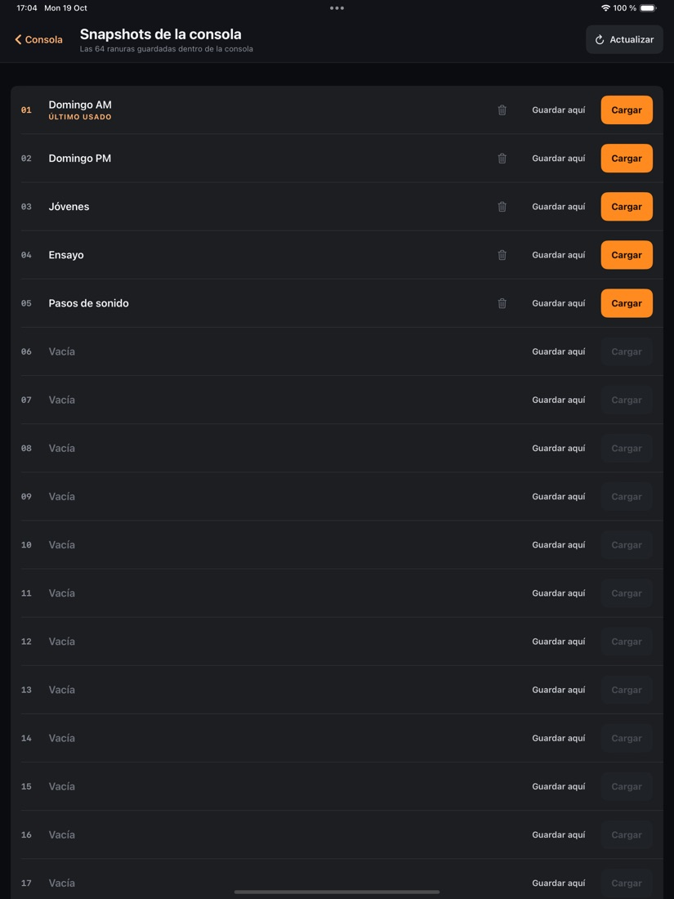</p>

*Ajustes → Snapshots de la consola.* Son las **64 memorias internas de la propia XR18**, no de la app.

- Cada ranura muestra su número y nombre, o **Vacía**. La última usada lleva la etiqueta **ÚLTIMO USADO**.
- **Cargar**: aplica ese snapshot (pide confirmación; los faders y ajustes pueden saltar, no lo hagas con la banda
  tocando). Antes, la app hace una copia de seguridad para poder volver.
- **Guardar aquí**: guarda el estado actual en esa ranura (pide un nombre de hasta 31 caracteres y confirma que
  reemplaza el contenido).
- **Actualizar**: vuelve a leer la lista de la consola.
- **Eliminar**: vacía la ranura (con confirmación).

> Estos comandos siguen el documento oficial del protocolo, pero **aún están pendientes de comprobar en una consola
> real**. Úsalos primero fuera de servicio.

---

## 9. Idioma

La app sigue el idioma del dispositivo (español si el iPad/iPhone está en español, si no, inglés). Para cambiarlo:
el **globo** en la pantalla de conexión, o *Ajustes → Idioma*: **Sistema**, **English**, **Español**.

---

### Tamaño de texto

Las páginas con mucho texto (Ajustes, Conexión, Copia de ajustes, Ayuda, Grupos de mute, Vincular) siguen el tamaño de
texto del sistema (*Ajustes del dispositivo › Pantalla y brillo › Tamaño del texto*). Los faders y las tiras de canal
mantienen un tamaño fijo para que no cambien de sitio durante un servicio.

---

## 10. Preguntas frecuentes

**No encuentro la consola.** Comprueba que el dispositivo esté en la **misma red** que la XR18 (no la red de
invitados), permite el acceso a la red local y, si no aparece, escribe su IP. *Revisar mi red* te dice qué falla.

**Se movió un fader solo.** Ve el borde blanco con ↻: otro dispositivo (u otra persona) lo movió. Usa **Deshacer**
para revertir los cambios hechos desde esta app.

**Silencié por error.** Toca **MUTE** otra vez, o **Deshacer (↶)**.

**Apagué la consola y se perdieron los ajustes.** Al reconectar, la app lo detecta y ofrece **Revisar y restaurar**
(o lo hace sola si activaste *Restaurar automáticamente*).

**Quiero practicar sin riesgo.** Usa **Probar la consola de demostración** en la pantalla de conexión.

**El músico no puede cambiar de retorno.** Está configurado como *Bloqueado*. Vuelve a vincularlo con *Libre*.

---

## 11. Glosario

| Término | Significado |
|---|---|
| **Fader** | Control deslizante de volumen. |
| **Mute** | Silenciar. |
| **Solo** | Escuchar un canal aislado. |
| **Bus** | Mezcla auxiliar (por ejemplo, el retorno de un músico). |
| **FX** | Efectos (reverb, delay…). |
| **DCA** | Fader que controla a la vez un grupo de canales. |
| **Grupo de mute (MG)** | Grupo de canales que se silencian juntos. |
| **Main LR** | Salida principal (altavoces de la sala). |
| **Preamp / Ganancia** | Amplifica la señal del micrófono al entrar. |
| **+48V / Fantasma** | Alimentación para micrófonos de condensador. |
| **Polaridad (Ø)** | Inversión de fase. |
| **Corte de graves (LC)** | Filtro que elimina graves no deseados. |
| **Gate** | Silencia el canal cuando la señal es muy baja. |
| **Compresor / Dinámica** | Reduce la diferencia entre sonidos fuertes y suaves. |
| **EQ** | Ecualizador: ajusta graves, medios y agudos. |
| **Q** | Anchura de una banda de EQ. |
| **Snapshot** | Memoria interna de la consola (64 ranuras). |
| **Retorno** | La mezcla que escucha un músico en sus monitores o auriculares. |
| **dB / dBFS** | Decibelios / decibelios respecto al máximo digital. |
| **fw** | Versión de firmware de la consola. |
