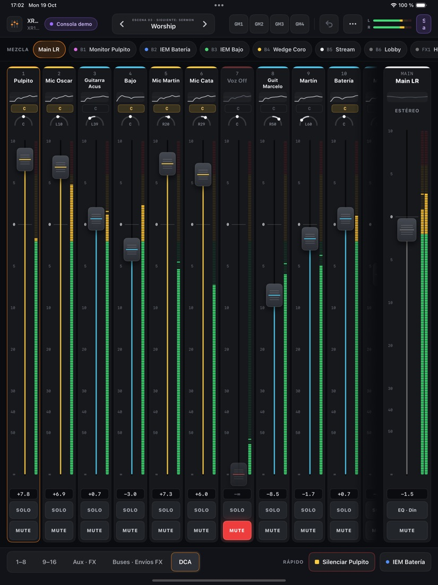
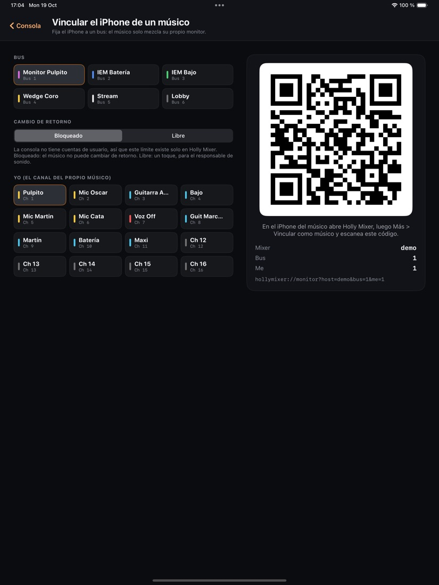
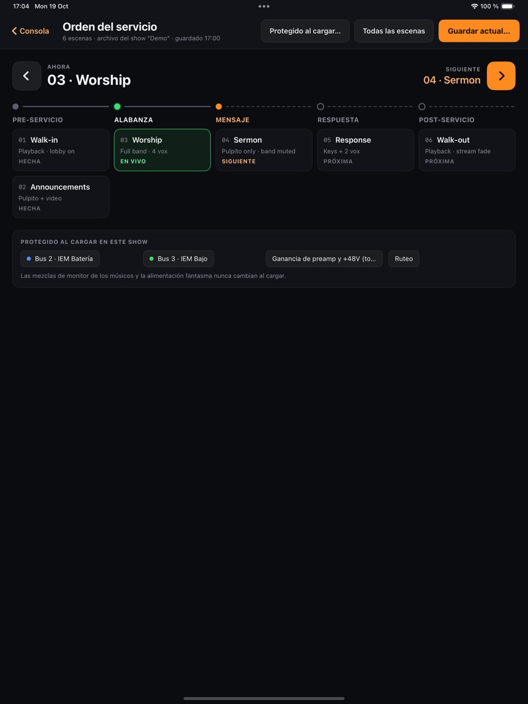
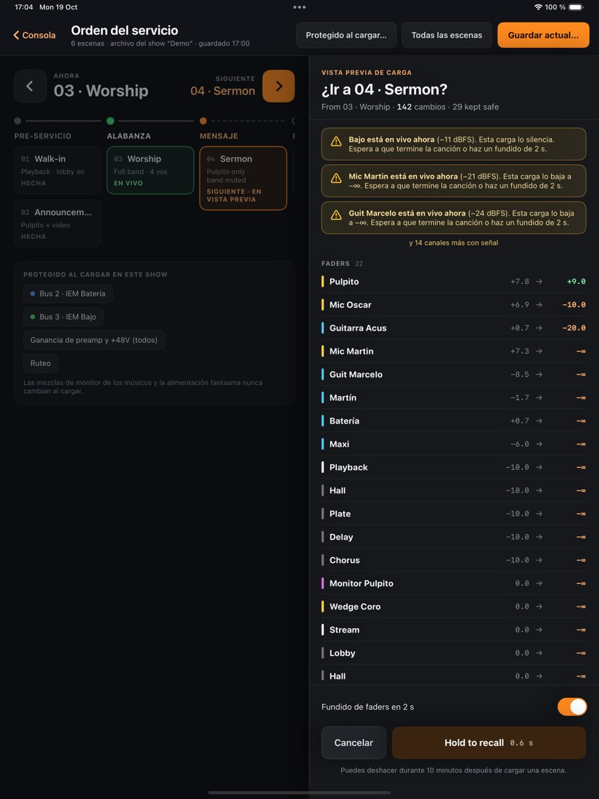

# Holly Mixer — Manual de usuario

Las capturas son de la consola de demostración.

Holly Mixer es un control remoto para consolas digitales **Behringer X AIR (XR18)**. Funciona en iPad y en
iPhone, y se conecta a la consola por Wi-Fi o por cable de red.

> ⚠️ **Todo lo que muevas en Holly Mixer cambia la consola de verdad**, y por lo tanto lo que suena en la sala.
> Si quieres practicar, usa la **consola de demostración** (ver [1.4](#14-consola-de-demostración)).

---

## Índice

1. [Conectar a la consola](#1-conectar-a-la-consola)
2. [Pantalla principal del iPad (la mesa de mezcla)](#2-pantalla-principal-del-ipad)
3. [Una tira de canal, botón a botón](#3-una-tira-de-canal-botón-a-botón)
4. [Página de un canal](#4-página-de-un-canal)
5. [El iPhone](#5-el-iphone)
6. [Modo músico («Mi mezcla»)](#6-modo-músico-mi-mezcla)
7. [Escenas y orden del servicio](#7-escenas-y-orden-del-servicio)
8. [Copia de seguridad de ajustes](#8-copia-de-seguridad-de-ajustes)
9. [Snapshots de la consola](#9-snapshots-de-la-consola)
10. [Idioma](#10-idioma)
11. [Preguntas frecuentes](#11-preguntas-frecuentes)
12. [Glosario](#12-glosario)

---

## 1. Conectar a la consola

Es la primera pantalla que ves al abrir la app.

### 1.1 Buscar la consola

<p align="center"></p>

| Elemento | Para qué sirve |
|---|---|
| **ENCONTRADAS EN ESTA RED** | Lista de consolas que respondieron en tu red. Cada una muestra modelo, versión de firmware (*fw*), dirección IP y latencia. Tócala para conectarte. |
| **Buscar de nuevo** | Repite la búsqueda. Mientras busca dice «Buscando». |
| **O ESCRIBE UNA DIRECCIÓN IP** + **Conectar** | Si la consola no aparece, escribe su IP (por defecto `192.168.1.2`) y toca *Conectar*. |
| **RECIENTES** | Consolas a las que ya te conectaste, con la IP y cuándo las usaste por última vez. Un toque para volver a conectar. |
| **Probar la consola de demostración** | Abre una consola simulada. Nada de lo que toques llega a la sala. |
| **Globo (idioma)** | Cambia entre Sistema, English y Español. |

Mientras conecta verás «Conectando a …». Si iOS pregunta por el acceso a la **red local**, toca **Permitir**:
sin ese permiso la app no puede hablar con la consola. Hay un botón **Cancelar** si te equivocaste de dirección.

### Si la IP de la consola cambia

La app no da por hecha ninguna dirección: la primera vez solo busca en la red. Si la dirección guardada deja de
responder (por ejemplo, el router le dio otra IP a la consola), la app **busca la consola sola** y se conecta a ella
cuando es claramente la misma (mismo nombre que una reciente, o la única encontrada). Si no, aparece en
**ENCONTRADAS EN ESTA RED** y la tocas.

### 1.2 Revisar mi red

Una tarjeta de ayuda con tres partes:

- **Revisar mi red / Run**: comprueba el tipo de conexión (Wi-Fi, Ethernet, solo datos móviles, sin red) y hace una
  prueba contra la IP escrita (o, si el campo está vacío, contra la consola encontrada): **¿Consola alcanzable?** (sí/no), **Latencia** (por debajo de 20 ms
  se siente instantáneo) y **Pérdida de paquetes**. Los botones son *Probar*, *Probar de nuevo*.
- **¿Por qué pide acceso a la «Red local»?**: explica el permiso. Si tocaste «No permitir», el botón **Abrir
  Ajustes** te lleva a *Ajustes › Privacidad y seguridad › Red local*.
- **¿No ves la consola?**: las redes Wi-Fi de invitados suelen impedir que los dispositivos se vean entre sí.
  Conéctate a la misma red que la consola y busca otra vez.

### 1.3 Si se corta la conexión

Aparece una franja naranja **«Se perdió la consola · reintentando»** y los controles quedan en solo lectura (se ven
apagados) hasta que la consola responda. El botón **Reintentar ahora** fuerza un nuevo intento. En la barra
superior el indicador pasa a **Reconectando…**.

### 1.4 Consola de demostración

Es una XR18 simulada con canales con nombre, faders, mutes y medidores que se mueven. Sirve para aprender o
enseñar a voluntarios. Mientras está activa, el indicador de conexión dice **Consola demo** y el botón de apagado
se convierte en **Salir de la demo**.

---

## 2. Pantalla principal del iPad

<p align="center"></p>

De arriba hacia abajo:

```
┌───────────────────────────────────────────────────────────────────────┐
│  CABECERA  (conexión · escena · MG1–4 · deshacer · más · medidor)     │
├───────────────────────────────────────────────────────────────────────┤
│  MEZCLA   [Main LR] [Bus 1] … [Bus 6] [FX 1] … [FX 4]                 │
├───────────────────────────────────────────────────────────────────────┤
│  (franjas de aviso: envíos / reconectando / copia de seguridad)       │
├───────────────────────────────────────────────────────────┬───────────┤
│  Tiras de canal (se desplazan hacia los lados)            │  MASTER   │
├───────────────────────────────────────────────────────────┴───────────┤
│  PIE:  [1–8] [9–16] [Aux · FX] [Buses · Envíos FX] [DCA]   RÁPIDO …   │
└───────────────────────────────────────────────────────────────────────┘
```

### 2.1 Cabecera (barra superior)

De izquierda a derecha:

| Elemento | Qué hace |
|---|---|
| **Logo** | La marca de la app. |
| **Nombre de la consola** y debajo **modelo · fw · IP** | Identifica a qué consola estás conectado (o «demo»). |
| **Indicador de conexión** | Verde «Conectado · 12 ms» = todo bien (la cifra es la latencia). Naranja «Reconectando…» = se perdió la consola. Azul/violeta «Consola demo» = simulación. |
| **SOLO · canal · Quitar** (solo aparece si hay solo) | Avisa de que hay canales en solo (escuchas en auriculares/monitor de sala, según la consola). Tócalo para **quitar todos los solos** de golpe. |
| **Control de escena** (`‹  ESCENA 3 · SIGUIENTE: …  ›`) | Muestra la escena en vivo y la siguiente. Las flechas abren la **vista previa** de la escena anterior/siguiente (no la cargan todavía). El centro abre el **Orden del servicio**. Ver [sección 7](#7-escenas-y-orden-del-servicio). |
| **MG1 · MG2 · MG3 · MG4** | Los 4 **grupos de mute** de la consola. Un toque silencia (se pone rojo) o reactiva todos los canales asignados a ese grupo. Los grupos se asignan en la propia consola. |
| **Deshacer (↶)** | Revierte el último cambio hecho desde la app. Un punto naranja indica que hay cambios por deshacer. **Mantén pulsado** para ver la lista de los últimos 8 cambios con su hora. Guarda hasta 100 cambios. |
| **Más (⋯)** | Menú de páginas poco frecuentes (ver 2.2). |
| **Medidor Main L/R** | Dos barritas con el nivel de la salida principal. |
| **Apagar (⏻)** / **Salir de la demo** | Desconecta de la consola y vuelve a la pantalla de conexión. |

En pantallas estrechas (iPad en multitarea, iPhone horizontal) se ocultan el control de escena, MG1–4 y el
medidor para ganar espacio.

### 2.2 Menú «Más (⋯)»

| Opción | Para qué sirve |
|---|---|
| **Orden del servicio** | Abre las escenas ([sección 7](#7-escenas-y-orden-del-servicio)). |
| **Vincular el iPhone de un músico** | Muestra un código QR para que un músico controle solo su mezcla de monitor ([sección 6](#6-modo-músico-mi-mezcla)). |
| **Copia de ajustes** (*Settings backup*) | Copias de seguridad ([sección 8](#8-copia-de-seguridad-de-ajustes)). |
| **Snapshots de la consola** | Las 64 memorias internas de la consola ([sección 9](#9-snapshots-de-la-consola)). |
| **Idioma** | Sistema / English / Español. |

> *Iniciar / Editar Modo Servicio* existen en el código pero están **ocultos en esta versión**.

### 2.3 Selector de mezcla («MEZCLA»)

<p align="center"></p>

Una fila de píldoras: **Main LR**, **Bus 1 … Bus 6** y **FX 1 … FX 4**. Decide **qué controlan los faders**:

- **Main LR**: los faders son los niveles normales de cada canal hacia la salida principal.
- **Un bus (1–6)**: los faders pasan a ser **envíos** de cada canal a ese bus. Es la forma de armar la mezcla de
  monitor / retorno de un músico. El bus elegido se pinta con su color.
- **FX 1–4**: igual, pero hacia los efectos.

Cuando eliges un bus aparece una franja de color: **«Los faders son envíos a …»** con el botón **Volver a Main**.

### 2.4 Franjas de aviso

- **Envíos / Volver a Main**: ver arriba.
- **Se perdió la consola**: ver [1.3](#13-si-se-corta-la-conexión).
- **Copia de seguridad** (naranja): «Los ajustes de la consola cambiaron desde tu última sesión». Pasó, por ejemplo,
  si la consola se apagó y encendió y perdió ajustes. Dos botones: **Revisar y restaurar** y **Mantener los de la
  consola**. Ver [sección 8](#8-copia-de-seguridad-de-ajustes).

### 2.5 Pie de página (bancos de canales)

<p align="center"></p>

Selector para elegir **qué tiras ves**:

| Banco | Contenido |
|---|---|
| **1–8** | Canales de entrada 1 a 8. |
| **9–16** | Canales 9 a 16. |
| **Aux · FX** | Entrada auxiliar y los 4 retornos de efectos. |
| **Buses · Envíos FX** | Los 6 buses y los 4 envíos de FX (solo con *Main LR*). |
| **DCA** | Los 4 grupos DCA (solo con *Main LR*). |

Al tocar un banco la fila se desplaza hasta ese punto. (La fila completa también se puede arrastrar a mano.)

A la derecha del pie, en iPad ancho, hay **RÁPIDO** con atajos: silenciar/reactivar el canal 1, saltar a la mezcla
del Bus 2, o **Volver a Main** cuando estás dentro de un bus.

---

## 3. Una tira de canal, botón a botón

Cada canal es una columna. De arriba a abajo:

| Parte | Qué es / qué hace |
|---|---|
| **Barra de color** | El color del canal (se cambia en la página del canal). Se atenúa si el canal está en mute. |
| **Número y nombre** | Ej. `1 · Pulpito`. **Un toque** selecciona el canal (borde naranja). **Un segundo toque** (ya seleccionado) abre su página de detalle. Los canales sin nombre se ven más apagados. |
| **Miniatura de EQ** | Dibujo pequeño de la curva de ecualización actual. |
| **G / C** | Indicadores de **G**ate y **C**ompresor. Encendidos (verde / ámbar) = ese procesador está activo. Son solo informativos. |
| **Arco de pan** | Posición estéreo: `C` = centro, `L39` = 39 % a la izquierda, `R29` = 29 % a la derecha. Solo informativo (se edita en la consola). |
| **Fader** | Control de volumen. Ver 3.1. |
| **Medidor LED** | Nivel de señal: verde = normal, ámbar = alto, rojo = cerca de saturar. La marca fija arriba es el **pico**. En canales estéreo hay dos columnas (L y R). |
| **Lectura en dB** | Valor actual, ej. `-6.0`. Se pone naranja mientras mueves el fader. «−∞» = silencio total. |
| **SOLO** | Pone el canal en solo. Se enciende en ámbar. No todos los elementos lo tienen. |
| **MUTE** | Silencia el canal. Se enciende en rojo. Vuelve a tocarlo para reactivar. El botón vibra levemente al pulsar. |
| **Borde blanco + ↻** | Aviso de **«Cambiado en otro dispositivo»**: otra persona (otro iPad, la consola o X AIR Edit) movió ese canal hace un instante. |

### 3.1 El fader

- **Arrastra la tapa** hacia arriba o abajo. La tapa **no salta** hasta tu dedo: se mueve relativa a donde pusiste
  el dedo, para evitar tirones.
- Mientras arrastras aparece una burbuja naranja con el valor en dB.
- **Doble toque** en el fader lo devuelve a **0 dB** (posición «unidad»).
- La escala a la izquierda va de **+10** a **−∞**; el **0** se resalta.
- **Solo la tapa mueve el fader.** Si pasas el dedo en horizontal por encima de varios faders para desplazar la
  fila, no se mueven (hace falta un gesto vertical claro).

### 3.2 La tira MASTER (a la derecha, más ancha)

<p align="center"></p>

Siempre visible: es **Main LR** (o el **bus / FX** que tengas seleccionado en *MEZCLA*). Tiene lo mismo que una tira
normal, más:

- Etiqueta **MONO** o **ESTÉREO**.
- Botón **EQ · Din** (o **EQ de bus · Din**): abre la página con el EQ y la dinámica del master.

### 3.3 Tiras de bus, FX y DCA

- **Buses y envíos FX** (banco *Buses · Envíos FX*): igual que un canal, con su fader y mute.
- **DCA 1–4**: un fader que **mueve a la vez todos los canales asignados** a ese grupo, sin cambiar los faders
  individuales de cada uno. Muestra el nombre del grupo y cuántos canales tiene. Su **MUTE** silencia todo el grupo.
  Los canales se asignan a un DCA desde su página (*Config.*).

### 3.4 iPhone en horizontal

Al girar el iPhone se usa esta misma pantalla en versión compacta: se ocultan la miniatura de EQ, G/C y el arco de
pan; **SOLO y MUTE van lado a lado** y las barras se hacen más delgadas para que quepa todo.

---

## 4. Página de un canal

<p align="center"></p>

**Cómo abrirla:** selecciona el canal y toca otra vez su nombre (o, en el master, toca **EQ · Din**). En iPhone,
toca el nombre en la fila o desliza hacia la izquierda.

### 4.1 Barra superior

| Elemento | Para qué sirve |
|---|---|
| **Nombre y subtítulo** | Ej. «Pulpito — Entrada 1». |
| **‹ ›** | Pasa al **canal anterior / siguiente** sin volver a la mezcla (solo entradas 1–16). |
| **Chips de estado** | De un vistazo: **+48V activo/apagado**, **Ganancia**, **LC** (corte de graves) con su frecuencia o «LC apagado». |
| **Deshacer** | Igual que en la pantalla principal. |
| **Listo** | Cierra la página. |

### 4.2 Pestañas

Un **punto verde** junto al nombre de la pestaña indica que esa sección está **encendida** (Gate, EQ, Dinámica).
Cada tipo de elemento muestra solo las pestañas que le corresponden (los buses no tienen *Entrada*, por ejemplo).

#### Entrada

<p align="center"></p>
Solo canales de entrada.

| Control | Para qué sirve |
|---|---|
| **Ganancia del preamp (perilla GANANCIA)** | Sube o baja la señal del micrófono, de −12 a +60 dB. Arrastra la perilla hacia arriba o abajo. Junto a ella, un medidor **NIVEL** para ajustar sin pasarte. |
| **Alimentación fantasma (+48V)** | Alimenta micrófonos de condensador. **Silencia el canal antes**: al cambiarla puede sonar un golpe fuerte. Al activarla la app pide confirmación porque puede **dañar micrófonos de cinta** y otras fuentes. |
| **Polaridad · Invertir (Ø)** | Invierte la fase de la señal. Útil cuando dos micrófonos captan la misma fuente y se «cancelan». |
| **Corte de graves (interruptor + perilla FREC)** | Filtra los graves no deseados (golpes de soporte, viento, retumbo). Se ajusta entre 20 y 400 Hz. |

#### Gate

<p align="center"></p>
Silencia automáticamente el canal cuando la señal baja de un nivel (quita ruido y bleed entre frases).

- Interruptor **Gate** (encendido/apagado) y gráfico **TRANSFERENCIA · ENTRADA → SALIDA (dB)**.
- **MODO**: EXP2, EXP3, EXP4 (expansor suave a más fuerte), **GATE** (cierre total) o **DUCK** (baja un canal cuando entra otro).
- **UMBRAL**: nivel por debajo del cual el gate actúa.
- **RANGO**: cuánto baja la señal cuando está cerrado.
- **ATAQUE**: qué tan rápido abre.
- **HOLD**: cuánto tiempo se mantiene abierto tras caer la señal.
- **RELEASE**: qué tan rápido cierra.

#### EQ
Ecualizador paramétrico (4 bandas en canales, 6 en buses y Main).

- **EQ in**: enciende o apaga todo el ecualizador (para comparar «con» y «sin»).
- **Gráfico interactivo**: arrastra un punto para cambiar **frecuencia** (horizontal) y **ganancia** (vertical);
  **pellizca** con dos dedos para cambiar la **Q** (ancho de la banda); **doble toque** reinicia esa banda.
  Una burbuja muestra los valores mientras arrastras.
- **Aplanar…**: pone todas las bandas en 0 dB (pide confirmación). No toca el corte de graves.
- **Tarjetas inferiores**: **LC** (corte de graves, con su interruptor y «12 dB/oct») y **Banda 1…n** con tipo
  (*Shelf de graves*, *Campana PEQ*, *Vintage VEQ*, *Shelf de agudos*, *Corte de agudos*), **FREC**, **GAN.** y **Q**.

#### Dinámica

<p align="center"></p>
Compresor (o expansor): controla los picos de nivel.

- Interruptor **Dinámica** y gráfico **TRANSFERENCIA**, más el medidor **REDUCCIÓN DE GANANCIA** (cuántos dB está
  bajando el compresor en este instante; «no disponible» si la consola no lo envía).
- **MODO**: COMP (compresor) o EXP (expansor). **DETECTOR**: PEAK (picos) o RMS (promedio). **ENVOLVENTE**: LIN o LOG.
- **RATIO**: cuánto se comprime (de 1.1:1 suave a 100:1 limitador).
- **UMBRAL**: nivel a partir del cual empieza a actuar.
- **CODO**: transición suave o brusca al llegar al umbral.
- **MAKEUP**: ganancia de compensación tras comprimir.
- **ATAQUE / HOLD / RELEASE**: tiempos de respuesta.
- **MEZCLA**: porcentaje de señal comprimida vs. original (compresión paralela).
- **Tiempo automático**: la consola elige los tiempos por ti.

#### Envíos

<p align="center"></p>
Una fila por cada destino: **6 buses** y **4 FX**. Cada fila tiene el nombre y color del destino, un deslizador
y el valor en dB. Es el nivel que ese canal manda a cada mezcla de monitor o efecto.

#### Config.

<p align="center"></p>

| Tarjeta | Para qué sirve |
|---|---|
| **Nombre** | Renombra el canal (máx. 12 caracteres, con contador). Se guarda al terminar de escribir. |
| **Color** | 8 colores: gris, rojo, verde, amarillo, azul, magenta, cian, blanco. |
| **Grupos DCA** | Marca a qué DCA (1–4) pertenece el canal. Un toque suma o quita. |
| **Fader** | Deslizador de nivel y botón **MUTE** grande. |

### 4.3 Fader lateral — «MUEVE MIENTRAS EDITAS»

En iPad, a la derecha de la página hay un fader con medidor, indicadores GATE/DIN, SOLO y MUTE del canal. Así puedes
**ajustar el volumen mientras editas** el EQ o la dinámica, sin salir de la página.

---

## 5. El iPhone

### 5.1 Vertical: lista de faders horizontales

<p align="center"></p>

La cabecera tiene:

| Elemento | Qué hace |
|---|---|
| **Indicador de conexión** | Igual que en el iPad. |
| **Nombre de la mezcla ▾** (grande, ej. «Main LR») | Menú para elegir la mezcla: Main LR, Bus 1–6, FX 1–4. Decide qué controlan los faders. |
| **Deshacer (↶)** | Revierte el último cambio. |
| **Escenas** | Abre el Orden del servicio. |
| **Más (⋯)** | Vincular como músico…, Copia de ajustes, Snapshots de la consola, Idioma y **Desconectar**. |

<p align="center"> </p>

Cada **fila de canal** tiene:

- **M** (mute, rojo) y **S** (solo, ámbar).
- Barra de color, número, nombre y **dB**. **Toca el nombre** (o desliza a la izquierda) para abrir la página del canal.
- Un **fader horizontal** con medidor integrado. Se arrastra de la misma manera que el vertical.

**Barra inferior (bancos):** `1–9` · `10–16` · `FX` · `Buses` (en un bus aparece `Master`) · `DCA`.

### 5.2 Horizontal

Al girar el iPhone aparece la misma mesa del iPad en versión compacta (ver [3.4](#34-iphone-en-horizontal)).

---

## 6. Modo músico («Mi mezcla»)

Permite que **cada músico regule su propio monitor desde su iPhone**, sin poder tocar nada más de la mezcla.

### 6.1 Preparar (en el iPad de la mesa de sonido)

<p align="center"></p>

*Más (⋯) → Vincular el iPhone de un músico.*

| Control | Para qué sirve |
|---|---|
| **BUS** | Elige el bus de monitor de ese músico (el retorno que escucha). |
| **YO (EL CANAL DEL PROPIO MÚSICO)** | Elige el canal del propio músico para destacarlo en su mezcla. |
| **CAMBIO DE RETORNO** | Define si el músico puede cambiar de retorno: **Bloqueado** (no puede) o **Libre** (un toque, pensado para el responsable de sonido). Explica que esta limitación existe solo dentro de Holly Mixer, porque la consola no tiene cuentas de usuario. |
| **Código QR** | Se muestra a la derecha, junto con los datos escritos debajo. |

### 6.2 Vincular (en el iPhone del músico)

*Más (⋯) → Vincular como músico…* Apunta la cámara al QR del iPad. Si la cámara no funciona, toca **Escribir a mano**
y rellena la dirección de la consola, el bus y el canal, luego **Unirse**.

### 6.3 La pantalla del músico

<p align="center"></p>

| Elemento | Qué hace |
|---|---|
| **MI MEZCLA** y nombre del bus | Indica qué mezcla estás controlando. |
| **Solo el bus N** (candado) o **Retorno** | Si está bloqueado, muestra el candado. Si es libre, **Retorno** abre una lista para elegir otro bus: marca cada retorno como *En uso* o *Sin usar* y tiene el interruptor **Mostrar retornos sin usar**. Solo cambia el retorno: tu canal sigue igual. |
| **Mantén para salir** | Para salir del modo músico hay que **mantener pulsado dos segundos** y luego confirmar (evita salidas accidentales). |
| **YO** | Tu propio canal, fijado arriba, con su fader (cuánto te oyes en tus oídos). |
| **Otras entradas** | Un fader por cada canal activo para subir o bajar a los demás en **tu** mezcla. **Mostrar todas las entradas / Ocultar entradas sin usar** muestra u oculta las que no tienen nombre. |
| **EN MIS OÍDOS** | Fader maestro del bus: el volumen total de tu mezcla. |

El músico **solo** mueve los envíos de su bus; no cambia faders, mutes ni nada de la mezcla principal.

---

## 7. Escenas y orden del servicio

Una **escena** es una «foto» de la mesa: guarda **cada fader, mute, pan, nivel de envío y los grupos de mute**. Sirve
para dejar la consola lista para cada parte del servicio con un solo gesto.

Para abrirlo: *Más (⋯) → Orden del servicio*, el centro del control de escena en la cabecera, o el botón **Escenas**
en iPhone.

### 7.1 Barra superior de la página

| Botón | Qué hace |
|---|---|
| **Guardar actual…** (naranja) | Guarda el estado actual de la consola como escena nueva. Pide nombre, una nota opcional («Solo púlpito · banda en mute») y la **Sección**. |
| **Todas las escenas** | Lista completa en orden, con las mismas acciones que las tarjetas. |
| **Protegido al cargar…** | Ver 7.4. |

### 7.2 Secciones y tarjetas

<p align="center"></p>

Las escenas se agrupan en **PRE-SERVICIO · ALABANZA · MENSAJE · RESPUESTA · POST-SERVICIO**. Cada tarjeta muestra su
número, nombre, nota y una etiqueta de estado (**EN VIVO**, **HECHA**, **PRÓXIMA**, **EN VISTA PREVIA**).

- **AHORA / SIGUIENTE** (franja superior con flechas ‹ ›): escena en vivo y la que sigue. Las flechas abren la vista
  previa de la anterior o siguiente.
- **Toca una tarjeta** → abre la **vista previa** de esa escena.
- **Mantén pulsada una tarjeta** → menú: **Ver vista previa**, **Renombrar o mover…**, **Mover antes**, **Mover
  después**, **Reemplazar con el estado actual de la consola**, **Eliminar** (pide confirmación).

### 7.3 Vista previa de carga (antes de aplicar)

<p align="center"></p>

Nunca se carga una escena «a ciegas». Antes ves **qué cambiaría**:

- Título **«¿Ir a Escena 2?»** y el recuento de cambios y de valores **protegidos**.
- Una lista agrupada en **FADERS / MUTES / ENVÍOS / PAN** con `de → a` por cada cambio. «La consola ya coincide con
  esta escena» si no hay nada que cambiar.
- **Aviso rojo «… está en vivo ahora»**: si un canal con señal (suena ahora mismo) va a ser bajado o silenciado, te
  lo advierte con su nivel. Espera a que termine la canción o usa el fundido.
- **Fundido de faders en 2 s**: en lugar de saltar, los faders se mueven suavemente en 2 segundos.
- **Cancelar** y el botón **Mantén para cargar**: hay que **mantenerlo pulsado** un instante (0,6 s) para confirmar;
  evita cargas por un toque accidental.
- Después de cargar aparece **Deshacer carga**, disponible durante **10 minutos**.

Antes de cada carga, la app guarda automáticamente una **copia de seguridad** del estado actual (ver sección 8).

### 7.4 Protegido al cargar (recall safe)

Cosas que **nunca cambian** al cargar una escena. Siempre protegidos: las **mezclas de monitor de los músicos** (envíos
a ciertos buses, fader y mute de esos buses) y la **alimentación fantasma**.

- **Buses**: marca los buses que no quieras que cambien (ideal para los retornos de los músicos).
- **Omitir estos canales**: lista de canales que la carga debe ignorar.

---

## 8. Copia de seguridad de ajustes

<p align="center"></p>

Una XR18 **olvida sus ajustes si se apaga**. Holly Mixer los guarda **en el propio dispositivo** unos segundos
después de cada cambio, para poder devolverlos. Guarda niveles, mutes, nombres, EQ, gate, dinámica, preamp, envíos y
grupos de mute.

*Más (⋯) → Copia de ajustes.*

### 8.1 Cuando la consola «se ve distinta»

Al conectar, si lo que hay en la consola difiere de la última copia, aparece una franja naranja (o un panel «LA
CONSOLA SE VE DISTINTA») con:

- **Revisar y restaurar**: te muestra, agrupado, cada valor que cambiaría. Debajo hay un interruptor **Restaurar
  también la alimentación fantasma +48V**, **apagado por defecto** (cambiarla con el sistema en vivo puede causar golpes
  o dañar micrófonos de cinta). Luego **Restaurar** y una confirmación final.
- **Mantener los de la consola**: descarta la diferencia y sigue con lo que tiene la consola.

### 8.2 Ajustes de la página

| Control | Qué hace |
|---|---|
| **Copia de seguridad automática** | Guarda en segundo plano tras cada cambio. |
| **Restaurar automáticamente** | Si la consola vuelve reseteada, cuenta **10 s** («Restaurando tus ajustes en N s») y devuelve la última copia. Puedes **Cancelar** en cualquier momento. **Espera** mientras haya sonido en la sala. |
| **Guardar ahora…** | Guarda una copia manual con nombre (p. ej. «Domingo, estado ideal»). |
| **Importar** | Trae una copia exportada desde otro dispositivo. |

### 8.3 Lista «AJUSTES GUARDADOS»

Cada copia muestra su nombre (o «Copia automática»), fecha y número de valores. Botones: **Revisar** (restaurarla),
**Compartir copia** (exportar), **Cambiar nombre** y **Eliminar**.

---

## 9. Snapshots de la consola

<p align="center"></p>

*Más (⋯) → Snapshots de la consola.* Son las **64 memorias internas de la propia XR18**, no de la app.

- Cada ranura muestra su número y nombre, o **Vacía**. La última usada lleva la etiqueta **ÚLTIMO USADO**.
- **Cargar**: aplica ese snapshot (pide confirmación; los faders y ajustes pueden saltar, no lo hagas con la banda
  tocando). Antes, la app hace una copia de seguridad para poder volver.
- **Guardar aquí**: guarda el estado actual en esa ranura (pide un nombre de hasta 31 caracteres y confirma que
  reemplaza el contenido).
- **Actualizar**: vuelve a leer la lista de la consola.
- **Eliminar**: vacía la ranura (con confirmación).

> Estos comandos siguen el documento oficial del protocolo, pero **aún están pendientes de comprobar en una consola
> real**. Úsalos primero fuera de servicio.

---

## 10. Idioma

La app sigue el idioma del dispositivo (español si el iPad/iPhone está en español, si no, inglés). Para cambiarlo:
el **globo** en la pantalla de conexión, o *Más (⋯) → Idioma*: **Sistema**, **English**, **Español**.

---

## 11. Preguntas frecuentes

**No encuentro la consola.** Comprueba que el dispositivo esté en la **misma red** que la XR18 (no la red de
invitados), permite el acceso a la red local y, si no aparece, escribe su IP. *Revisar mi red* te dice qué falla.

**Se movió un fader solo.** Ve el borde blanco con ↻: otro dispositivo (u otra persona) lo movió. Usa **Deshacer**
para revertir los cambios hechos desde esta app.

**Silencié por error.** Toca **MUTE** otra vez, o **Deshacer (↶)**.

**Apagué la consola y se perdieron los ajustes.** Al reconectar, la app lo detecta y ofrece **Revisar y restaurar**
(o lo hace sola si activaste *Restaurar automáticamente*).

**Quiero practicar sin riesgo.** Usa **Probar la consola de demostración** en la pantalla de conexión.

**El músico no puede cambiar de retorno.** Está configurado como *Bloqueado*. Vuelve a vincularlo con *Libre*.

---

## 12. Glosario

| Término | Significado |
|---|---|
| **Fader** | Control deslizante de volumen. |
| **Mute** | Silenciar. |
| **Solo** | Escuchar un canal aislado. |
| **Bus** | Mezcla auxiliar (por ejemplo, el retorno de un músico). |
| **FX** | Efectos (reverb, delay…). |
| **DCA** | Fader que controla a la vez un grupo de canales. |
| **Grupo de mute (MG)** | Grupo de canales que se silencian juntos. |
| **Main LR** | Salida principal (altavoces de la sala). |
| **Preamp / Ganancia** | Amplifica la señal del micrófono al entrar. |
| **+48V / Fantasma** | Alimentación para micrófonos de condensador. |
| **Polaridad (Ø)** | Inversión de fase. |
| **Corte de graves (LC)** | Filtro que elimina graves no deseados. |
| **Gate** | Silencia el canal cuando la señal es muy baja. |
| **Compresor / Dinámica** | Reduce la diferencia entre sonidos fuertes y suaves. |
| **EQ** | Ecualizador: ajusta graves, medios y agudos. |
| **Q** | Anchura de una banda de EQ. |
| **Escena** | Foto guardada del estado de la mesa. |
| **Snapshot** | Memoria interna de la consola (64 ranuras). |
| **Retorno** | La mezcla que escucha un músico en sus monitores o auriculares. |
| **dB / dBFS** | Decibelios / decibelios respecto al máximo digital. |
| **fw** | Versión de firmware de la consola. |
